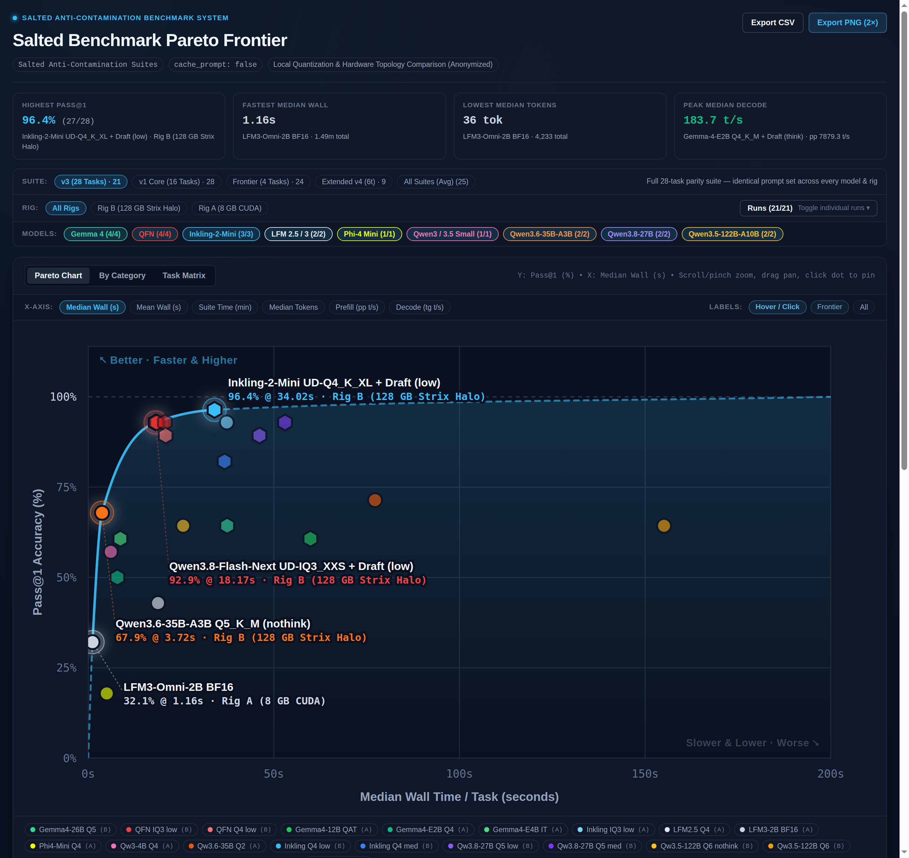

# Salted LLM Benchmark Suite & Pareto Telemetry

[](https://chrismarentette.github.io/salted-bench/)

**[Launch Interactive Pareto Dashboard ->](https://chrismarentette.github.io/salted-bench/)**

[](https://chrismarentette.github.io/salted-bench/)

*Click the preview above to open the live zero-CDN interactive dashboard (`Pass@1` vs. median wall time, suite/system/model-family filters, Category & Task Matrix tabs, power/wattage telemetry, and CSV/PNG export).*

---

Zero-dependency, anti-contamination benchmark suite and static Pareto dashboard for comparing local quantization, speculative decoding (MTP / DSpark), reasoning effort tiers, and hardware memory topologies.

## Suites
- **`salted-eval.py`** (`v1` 16 tasks / `v2` 24 tasks / `v3` 28 tasks): PRNG-salted coding, symbolic reasoning, strict JSON/schema, long-context, agent tool-use, ops/voice, and frontier ceiling tasks with deterministic graders, in-flight `perf_floor` checks, `llama_version` stamping, and `run_validity` quarantine.
- **`extended_v4_tasks.py`** (`6` tasks): Epistemic honesty (impossible modular spec + missing-key abstention), surgical minimal unified diff & JSON patch, and 2-turn self-correction recovery with `ttft_ms`, `token_efficiency_ratio`, `wall_cv`, and wattage telemetry.
- **`salted-agentic.py`** (`11` tasks): Multi-turn sandboxed harness testing read-before-write discipline, probe honesty, anti-loop pivoting, prompt-injection immunity, real-world codebase fixes, and epistemic impossibility (`P vs NP`).
- **`refusal-eval.py`**: Blind refusal & benign false-refusal evaluator (summary-only output, never logs raw prompts).
- **`pareto-dashboard.py`**: Builds the standalone single-file HTML dashboard (`--anonymize` ON by default, filters `invalidated` runs cleanly).

## Publishing Safely to GitHub Pages
```bash
python3 scripts/publish.py
```
`scripts/publish.py` rebuilds anonymized `salted-pareto-dashboard.html`, `index.html`, and `bench-ink-qw38-curve.md`, validates inline JS via `node --check`, and enforces a strict zero-PII/secret/IP leak scan before staging.
